# Concepts

The concept map of the GEF port links to [CODE](CODE.md), [DEFINITIONS](DEFINITIONS.md), [TESTS](TESTS.md) and [CAPTURES](CAPTURES.md).

## How to read the diagrams

- **Levels.** L1 is the whole project. Each L1 node opens one L2 diagram; deeper levels exist only where a node splits into at least three parts the Captain may want to point at, or where a rule's decisions are worth seeing. A heading `L<n> · <title> (`Parent`)` opens a structure diagram, `L<n> rule · <title> (`Parent`)` a rule diagram.
- **Arrows.** In structure diagrams a solid arrow carries what its label names; a dotted arrow means one node checks or limits another. In rule diagrams diamonds ask a question and arrows carry the answers.
- **Statuses.** Green `implemented`: built and proven. Yellow `partial`: in the current submilestone, built or not. Uncolored, dashed `planned`: committed by a plan, not started. Grey, dotted `external`: owned by another diagram and shown for context. A parent takes the highest status of its children (planned < implemented < partial), so the current work shows yellow up to L1.
- **Node IDs** are stable references: `CODE.md`, `TESTS.md`, `CAPTURES.md`, plans and receipts cite them. Every term in a node table is defined in `DEFINITIONS.md`.
- **Check:** the drift checker beside these files (command in the agent context) reports drift between them and the repository.

## L1 · GEF in C++
```mermaid
flowchart LR
classDef implemented fill:#c8e6c9,stroke:#2e7d32,color:#1b5e20
classDef partial fill:#fff3b0,stroke:#b58900,color:#5c4400
classDef planned stroke-dasharray:6 4
classDef external fill:#eeeeee,stroke:#9e9e9e,stroke-dasharray:1 3,color:#616161
ReferenceProgram["Reference program"] -->|DATA items from emitted C| ModelData["Model data"]
ReferenceProgram -->|source to patch and build| ReferenceHarness["Reference harness"]
FbRuntime["FreeBASIC runtime"] -->|BASIC numerics, random stream, text| PhysicsFunctions["Physics functions"]
ModelData -->|tables, parameters| PhysicsFunctions
ModelData -->|tables, parameters| RunControl["Run control"]
RunControl -->|bins of each step and pass| ModelTables["Model tables"]
PhysicsFunctions -->|function values| ModelTables
ModelTables -->|per-bin tables| EventGeneration["Event generation"]
RunControl -->|step and pass schedule| EventGeneration
EventGeneration -->|filled histograms| ResultAnalysis["Result analysis"]
ResultAnalysis -->|results, uncertainties| OutputWriting["Output writing"]
ReferenceHarness -->|captures, goldens| Comparison["Comparison"]
OutputWriting -->|output files| Comparison
BuildChecks["Build and checks"] -.->|exact FP mode, gates| FbRuntime
Comparison -.->|verdict on| RunControl
class ReferenceProgram,FbRuntime,ModelData,PhysicsFunctions,RunControl,ResultAnalysis,ReferenceHarness,Comparison,BuildChecks implemented
class ModelTables partial
class EventGeneration,OutputWriting planned
```

| Node | Meaning | Terms | Status |
| --- | --- | --- | --- |
| `ReferenceProgram` | GEF 2025/1.2 in FreeBASIC, the C fbc emits from it and the reference binary: the specification of the port, quirks included. | reference program, emitted C, quirk | implemented |
| `FbRuntime` | FreeBASIC's numeric, random-number, text, array and DATA behaviour, reproduced bit for bit. | FreeBASIC runtime, exact mode, random stream | implemented |
| `ModelData` | Nuclide, mass, shell and deformation tables, the nominal model parameters and their perturbation widths. | nuclide table, model parameter, perturbation width | implemented |
| `PhysicsFunctions` | GEF's deterministic physics functions: masses, barriers, level densities, yields, shapes and the gamma cascade. | physics function, T1 | implemented |
| `RunControl` | Reads the batch input, plans files, systems, energy steps and passes, sets up each system and step, and writes the console. | batch input, energy step, pass, state scope | implemented |
| `ModelTables` | The per-nucleus tables built for each bin before its events: modes, deformations, barriers, widths, yields, even-odd, energy sorting and spins. | bin, model table, carried state | partial |
| `EventGeneration` | The samplers, the multi-chance pre-pass and the Monte Carlo event loop. | event, sampler, pre-pass | planned |
| `ResultAnalysis` | The analyzer registry and histograms, projections, isomers, decay and uncertainties. | analyzer, histogram, uncertainty | implemented |
| `OutputWriting` | GEF's output files: results, dumps, ENDF-6 tapes and side files. | output file, ENDF-6 tape, dump | planned |
| `ReferenceHarness` | Patched, seeded and probed BASIC builds, function drivers, clean runs, the reference store and the goldens. | patch set, probe, capture, golden, reference store | implemented |
| `Comparison` | Parsers and the exact and statistical verdicts on two runs. | exact comparison, statistical verdict | implemented |
| `BuildChecks` | Exact floating-point compiler policy, build presets, toolchain pin and the local CI gates. | preset, exact mode, gate | implemented |

### L2 · Reference program (`ReferenceProgram`)
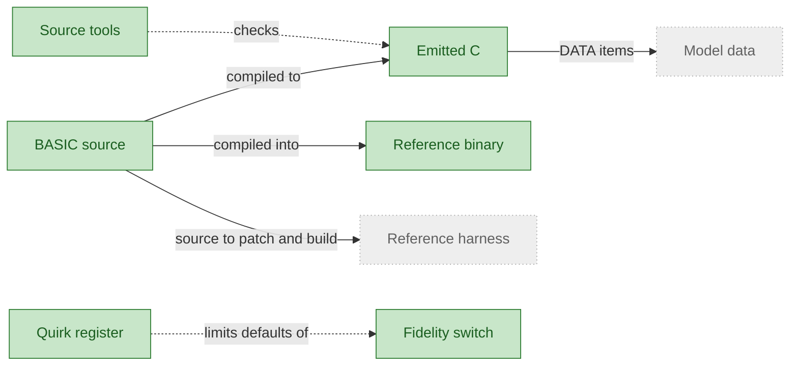

| Node | Meaning | Terms | Status |
| --- | --- | --- | --- |
| `BasicSource` | The GEF program as written in FreeBASIC, the specification that the port follows. | BASIC source | implemented |
| `EmittedC` | The C code that the FreeBASIC compiler generates from the BASIC source, keeping each part traceable to its BASIC line. | emitted C | implemented |
| `ReferenceBinary` | The executable built from the BASIC source, which produces the reference results. | reference binary | implemented |
| `SourceTools` | Tools that map BASIC lines and names onto the emitted C and compare pieces of that C. | source tool | implemented |
| `QuirkRegister` | The register of known differences between the BASIC program and its intent, each with its evidence and how the port keeps it. | quirk register, quirk | implemented |
| `FidelitySwitch` | A named setting that selects the corrected behaviour of one quirk, off by default so the port reproduces the BASIC behaviour. | fidelity switch, reproduce by default | implemented |
| `ReferenceHarness` | See GEF in C++. |  | external |
| `ModelData` | See GEF in C++. |  | external |

#### L3 · Source tools (`SourceTools`)
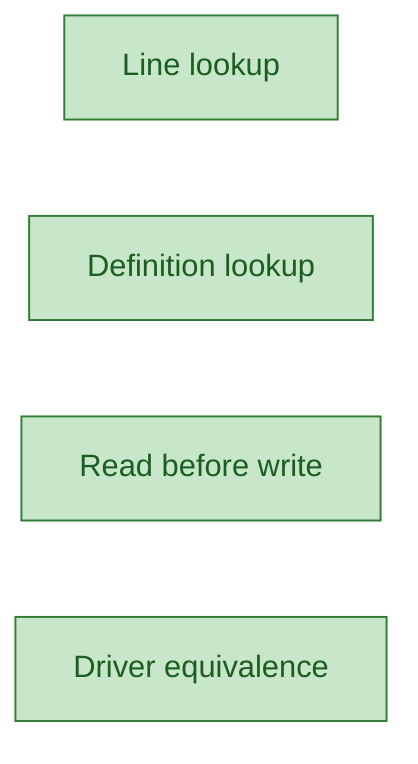

| Node | Meaning | Terms | Status |
| --- | --- | --- | --- |
| `LineLookup` | Shows the emitted C for one BASIC line. | emitted C | implemented |
| `DefinitionLookup` | Finds where a BASIC name is defined and where it is used. | definition lookup | implemented |
| `ReadBeforeWrite` | Lists the variables that a range of BASIC lines may read before writing them. | read before write | implemented |
| `DriverEquivalence` | Checks that a small driver program emits the same C as GEF for one function or range of lines. | emitted C | implemented |

#### L3 rule · Quirk register decisions (`QuirkRegister`)
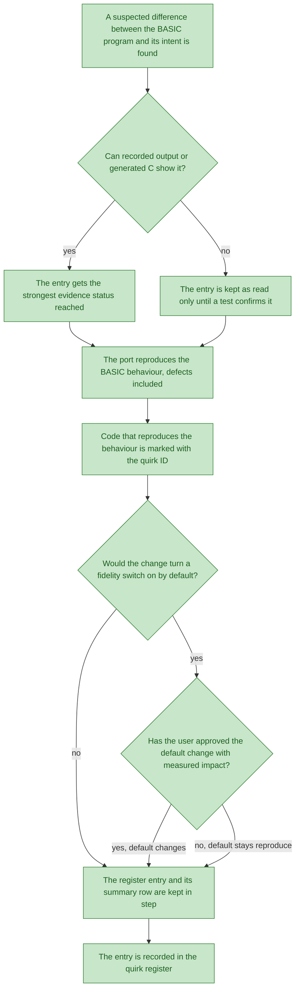

| Node | Meaning | Terms | Status |
| --- | --- | --- | --- |
| `RpNewQuirk` | A suspected difference between the BASIC program and its intent is found. | quirk | implemented |
| `RpStrongest` | The evidence decides which status the entry can take. | evidence status | implemented |
| `RpEntry` | The entry is recorded with the next free ID and the strongest evidence status reached. | quirk ID, evidence status | implemented |
| `RpReadOnly` | The entry is recorded as read only until a test confirms the difference. | evidence status | implemented |
| `RpReproduce` | The port reproduces the BASIC behaviour, defects included. | reproduce by default | implemented |
| `RpAnnotate` | Code that reproduces a quirk is marked with the quirk ID. | quirk ID | implemented |
| `RpSwitchDefault` | A change that would turn a fidelity switch on by default is a separate decision. | fidelity switch | implemented |
| `RpApproval` | A default change needs the user's approval and measured impact. | fidelity switch | implemented |
| `RpRegisterUpdate` | The register entry and its summary row are kept in step. | quirk register | implemented |
| `RpDone` | The entry is recorded in the quirk register. | quirk register | implemented |

### L2 · FreeBASIC runtime (`FbRuntime`)

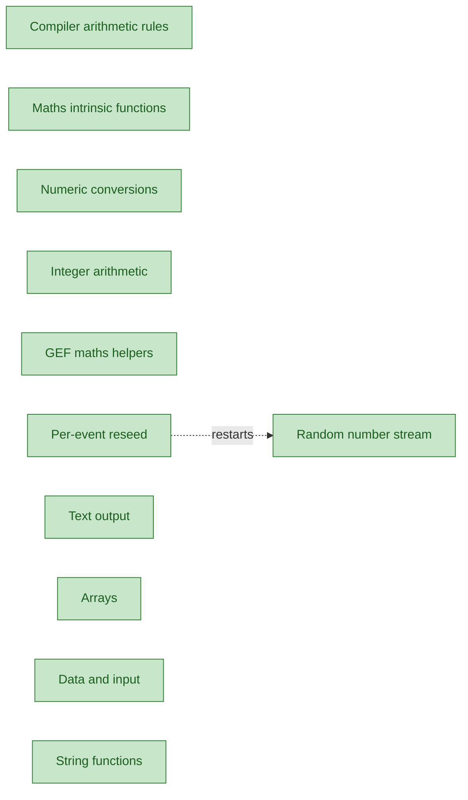

| Node | Meaning | Terms | Status |
|---|---|---|---|
| `FbArithmeticRules` | How the BASIC compiler types, reorders and folds the arithmetic of GEF expressions. The port must keep that order, because the results depend on it. | fbc expression rule | implemented |
| `FbIntrinsicMaths` | The built-in maths functions, such as exponential, logarithm, square root and absolute value. The argument type selects the precision of each call. | intrinsic function, argument type | implemented |
| `FbNumericConversions` | Conversion of floating-point values to integers, rounding to nearest with ties to even, and the Fix and Sgn functions. | numeric conversion, round to nearest, Fix function, Sgn function, out-of-range conversion | implemented |
| `FbIntegerArithmetic` | Integer division and modulo as BASIC defines them, with wrap-around on overflow and a trap for an undefined division. | integer division, Mod operator, wrap-around arithmetic, trap | implemented |
| `GefMathHelpers` | The maths functions that GEF defines itself, ported as written: minimum, maximum, error functions, hyperbolic tangent and cotangent, base-10 logarithm, floor, ceiling, round and modulo. | GEF maths helper | implemented |
| `FbRandomStream` | The sequence that the Rnd function gives after a Randomize statement, including the rule that Rnd with zero repeats the last value. | random stream, Rnd function, Randomize statement, master seed | implemented |
| `PerEventReseed` | Restarting the random stream at a seed derived from a master seed, so that a given event always starts from the same stream position. | reseed scope, derived seed | implemented |
| `FbTextOutput` | Turning values into the text that BASIC output statements and functions write. | text output | implemented |
| `FbArrays` | Arrays with BASIC bounds: index ranges, bounds checks, ReDim, and ReDim Preserve, which keeps the existing elements. | dynamic array, array bounds, ReDim Preserve statement | implemented |
| `FbDataInput` | Reading values from DATA statements and from input files, with the conversion of the text that is read. | input file, numeric text | implemented |
| `FbStringFunctions` | The BASIC string functions that trim blanks, change case, search text and cut out pieces of it. | Trim function, RTrim function, UCase function, InStr function, Mid function, Left function, Right function | implemented |

#### L3 · Text output (`FbTextOutput`)

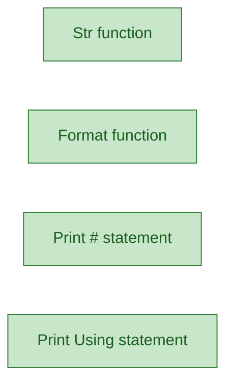

| Node | Meaning | Terms | Status |
|---|---|---|---|
| `StrFunction` | The text that the Str function gives for a Single, Double or LongInt value. | Str function, number text | implemented |
| `FormatFunction` | The text that the Format function gives for a value shaped by a format mask. | Format function, format mask | implemented |
| `PrintFileStatement` | Writing items to a file opened for output, with the separators and column stops that Print uses. | Print # statement, print separator, print zone, Tab function | implemented |
| `PrintUsingStatement` | Writing items through a template whose fields fix the layout of each value. | Print Using statement, template | implemented |

#### L3 · DATA and file input (`FbDataInput`)

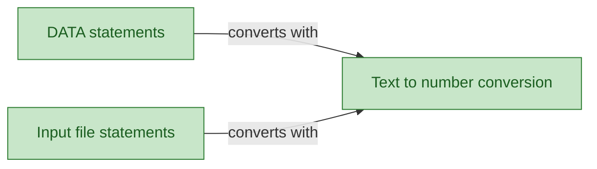

| Node | Meaning | Terms | Status |
|---|---|---|---|
| `DataStatements` | The items of DATA statements, read in order by READ and moved to a label by RESTORE. | DATA statement, READ statement, RESTORE statement, data label | implemented |
| `TextToNumber` | Numeric text turned into numbers with the Val family, which accepts radix prefixes and exponent letters. | Val function, ValLng function, ValInt function, numeric prefix | implemented |
| `InputFileStatements` | Tokens read from a file opened for input, with Input #, Line Input and the end-of-file test. | Input # statement, Line Input statement, EOF function, token | implemented |

#### L3 rule · Compiler rewriting of expressions (`FbArithmeticRules`)

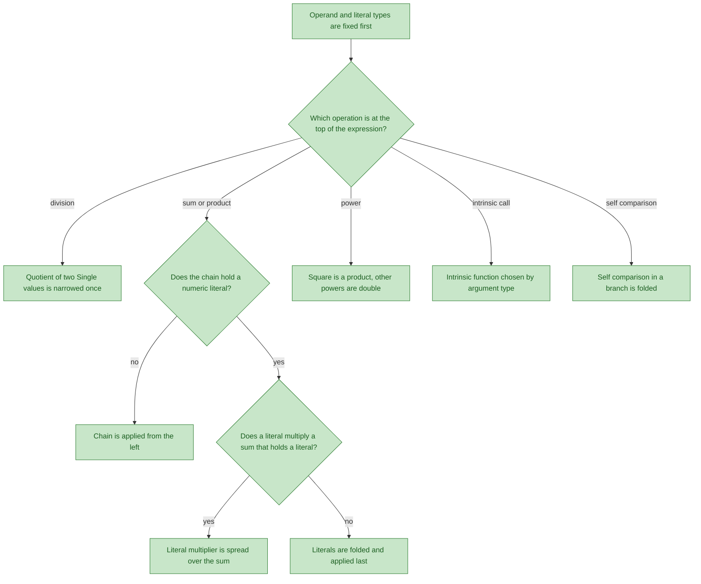

| Node | Meaning | Terms | Status |
|---|---|---|---|
| `FrOperandTypes` | Each literal and operand takes its type first, and the precision of each operation is fixed from its operands, left to right. | operand type, literal type, mixed precision | implemented |
| `FrExpressionForm` | The operation at the top of the expression decides which rule applies next. | top-level operation | implemented |
| `FrSingleQuotient` | A quotient of two Single values is computed in double precision and narrowed once. | Single quotient | implemented |
| `FrChainHasLiteral` | Whether a chain of sums or products holds a numeric literal decides how the chain is applied. | operator chain, numeric literal | implemented |
| `FrLeftToRight` | A chain without a literal is grouped from the left, and parentheses are not kept. | left-to-right chain | implemented |
| `FrIsLiteralOverSum` | Whether a literal multiplier acts on a sum that holds a literal decides how the product is formed. | literal multiplier | implemented |
| `FrLiteralDistributed` | The literal multiplier is spread over the sum, and the constants fold together. | literal distribution | implemented |
| `FrFoldLast` | The literals of the chain fold into one constant that is applied last. | literal folding | implemented |
| `FrPower` | A variable squared is a product; other powers are evaluated in double precision. | power operation | implemented |
| `FrIntrinsicByType` | An intrinsic function is chosen by the type of its argument. | intrinsic function, argument type | implemented |
| `FrSelfCompareFolded` | In a branch condition, a comparison of a variable with itself is folded to a constant. | self comparison | implemented |

### L2 · Model data (`ModelData`)

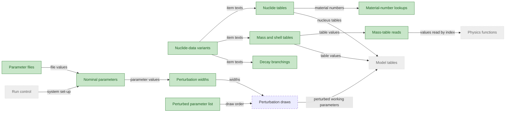

| Node | Meaning | Terms | Status |
| --- | --- | --- | --- |
| `NuclideDataVariants` | The alternative nuclear data sets GEF can run with, such as JEFF-3.3 or NUBASE 2016; each has its own nuclide list and data items, and one is chosen for each run. | nuclide-data variant, data item | implemented |
| `NuclideTables` | The nuclide list of the chosen variant, with each nucleus's material number, atomic weight ratio and isomeric states. | nuclide table, material number, isomeric state, atomic weight ratio | implemented |
| `DecayBranchings` | The decay mode and branching ratio recorded for each nucleus and isomeric state, with a default mode for nuclei the table does not list. | decay branch, branching ratio, default decay mode, branch table end | implemented |
| `MassShellTables` | The per-nucleus tables of mass, deformation, shell correction and even-odd effect that the physics reads from the nuclide data. | mass table, deformation, shell correction, even-odd effect | implemented |
| `MassTableReads` | What a read of a mass table returns for an index outside its own block: a neighbouring table's value, a size word or zero, or an error. | table block, out-of-range read, neighbouring table, size word, gap, overrun fix | implemented |
| `MatLookups` | Finds the material number of a nucleus from its proton and mass numbers; the result for a missing nucleus depends on the lookup form. | material number, nuclide, lookup form | implemented |
| `NominalParameters` | The model parameters at their starting values, which a run uses until a parameter file or a system's set-up changes them. | nominal parameter, model parameter, system | implemented |
| `PerturbationWidths` | The width of the random change each perturbed parameter receives, its starting width, and the update that sets the final widths of each system. | perturbation width, system | implemented |
| `PerturbedParameterList` | The fixed list of parameters that the uncertainty draws vary, in the order the draws use them. | perturbed parameter | implemented |
| `PerturbationDraws` | Each perturbed pass gives every perturbed parameter one Gaussian draw from its width, in list order; the drawn values become that pass's working parameters. | draw, perturbed pass, perturbed parameter, perturbation width | planned |
| `ParameterFiles` | The optional text files that change the nominal parameters, and the update file that lists the resulting values. | parameter file, update file | implemented |
| `RunControl` | See GEF in C++. |  | external |
| `ModelTables` | See GEF in C++. |  | external |
| `PhysicsFunctions` | See GEF in C++. |  | external |

#### L3 · Nuclide-data variants (`NuclideDataVariants`)

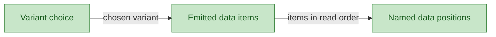

| Node | Meaning | Terms | Status |
| --- | --- | --- | --- |
| `VariantSelection` | Names the nuclide-data variant a run uses and the variant string that selects its code branches. | nuclide-data variant, variant string | implemented |
| `EmittedNuclideC` | The data items of the chosen variant, taken from the C code that the BASIC compiler emits, in the order the program reads them. | emitted C, data item | implemented |
| `DataItemLabels` | Maps each data label to the data block it names; lookups ignore letter case. | data label, DATA block | implemented |

#### L3 rule · Material-number lookup (`MatLookups`)

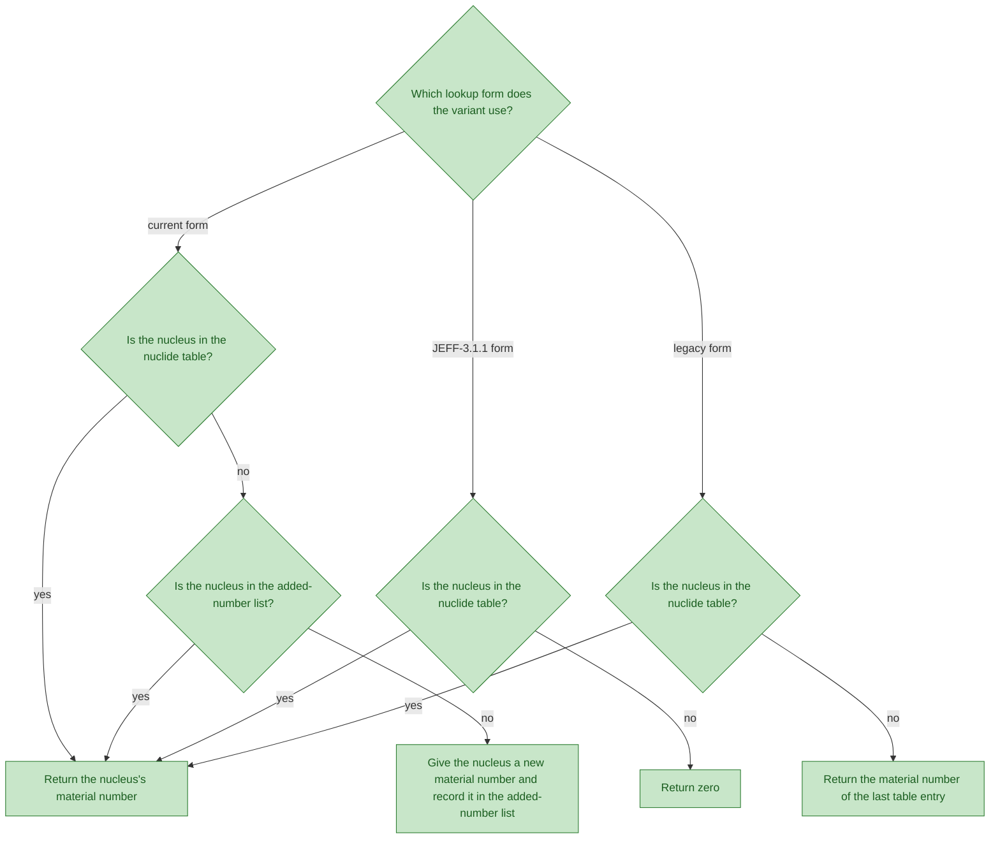

| Node | Meaning | Terms | Status |
| --- | --- | --- | --- |
| `MdLookupForm` | Chooses the lookup form from the nuclide-data variant. | lookup form | implemented |
| `MdCurrentFound` | Checks whether the nucleus is in the nuclide table of the current form. | nuclide, nuclide table | implemented |
| `MdSaved` | Checks whether the nucleus was already given a material number and kept in the added-number list. | nuclide, added-number list | implemented |
| `MdOldFound` | Checks whether the nucleus is in the nuclide table of the JEFF-3.1.1 form. | nuclide, nuclide table | implemented |
| `MdLegacyFound` | Checks whether the nucleus is in the nuclide table of the legacy form. | nuclide, nuclide table | implemented |
| `MdReturnNumber` | Returns the material number the nucleus already has. | material number | implemented |
| `MdAssignNew` | Gives a nucleus the table lacks a new material number and records it in the added-number list. | new material number, added-number list | implemented |
| `MdReturnZero` | Returns zero for a nucleus the JEFF-3.1.1 table lacks. | material number | implemented |
| `MdReturnLast` | Returns the material number of the last table entry for a nucleus the legacy table lacks. | legacy fallback, material number | implemented |

#### L3 · Parameter files (`ParameterFiles`)

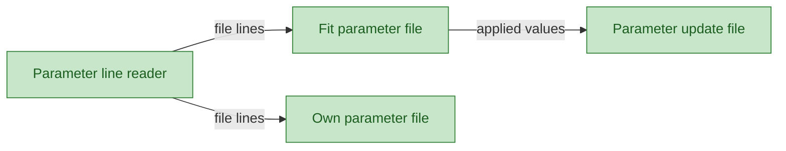

| Node | Meaning | Terms | Status |
| --- | --- | --- | --- |
| `ParameterLineReader` | Reads a parameter file line by line and sets the values its lines name; an unterminated comment makes the port stop with an error where the original program loops forever. | parameter file, unterminated comment | implemented |
| `FitparFile` | An optional file in the working folder that overrides the nominal values when it exists; it is read at start-up and again later in the run. | fit parameter file, working folder | implemented |
| `MyParametersFile` | A second optional parameter file, applied only when a flag is set; the original program never sets the flag, so the file has no effect. | own parameter file | implemented |
| `ParameterUpdateFile` | The text of the update file, listing the parameter values after the parameter files have been applied. | update file | implemented |

#### L3 rule · Reads outside a mass table (`MassTableReads`)

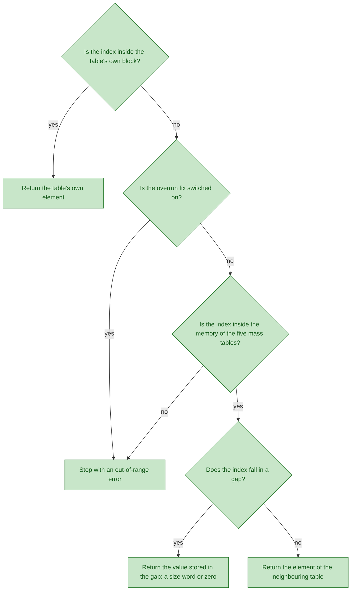

| Node | Meaning | Terms | Status |
| --- | --- | --- | --- |
| `MdInsideOwn` | Checks whether the index lies inside the table's own block. | table block | implemented |
| `MdOwnElement` | Returns the element the index names in the table itself. | table block, mass table | implemented |
| `MdFixOn` | Checks whether the overrun fix turns reads outside the tables into errors. | overrun fix, out-of-range read | implemented |
| `MdThrow` | The read stops with an out-of-range error. | out-of-range read | implemented |
| `MdInMemory` | Checks whether the index lies in the memory of the five consecutive mass tables. | table block, mass table | implemented |
| `MdGap` | Checks whether the index falls in a gap between two table blocks. | gap | implemented |
| `MdGapValue` | Returns what the gap holds: the size word stored before the next block, or zero. | gap, size word | implemented |
| `MdNeighbour` | Returns the element of the neighbouring table, as the original program does. | neighbouring table | implemented |

### L2 · Physics functions (`PhysicsFunctions`)

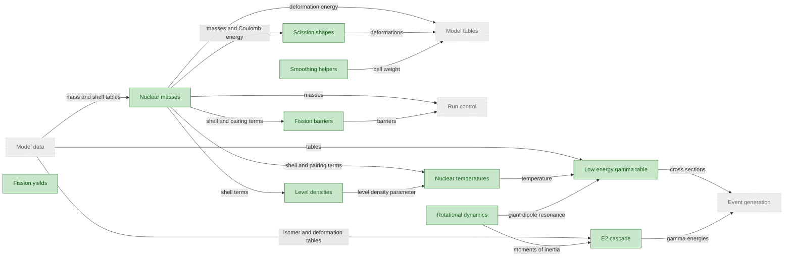

| Node | Meaning | Terms | Status |
| --- | --- | --- | --- |
| `NuclearMasses` | Masses of nuclei and the mass table they come from. | nuclear mass, mass table | implemented |
| `FissionBarriers` | Height of the barrier a nucleus must pass before it fissions. | fission barrier, Thomas Fermi model | implemented |
| `LevelDensities` | Number of nuclear states per unit of excitation energy, in the Fermi gas and Egidy forms. | level density, Fermi gas model, Egidy model | implemented |
| `NuclearTemperatures` | Temperature of a nucleus at a given excitation energy, derived from its level density. | nuclear temperature, level density parameter | implemented |
| `FissionYields` | Fragment yields of a fission event, computed from the temperature window at scission. | fission yield, temperature window | implemented |
| `ScissionShapes` | Shape of the nucleus at the moment it splits, with its deformations and charge split. | scission shape, charge equilibrium | implemented |
| `SmoothingHelpers` | Smoothed step, bell and box weights, and an even odd selector used by other groups. | smoothed step, bell function, box function, even odd selector | implemented |
| `RotationalDynamics` | Moments of inertia, fragment acceleration, and giant dipole resonance energy and width. | moment of inertia, fragment acceleration, giant dipole resonance | implemented |
| `EgammaLowTable` | Table of cross sections for low-energy gamma rays emitted by a fragment. | low energy gamma table | implemented |
| `E2Cascade` | Cascade of E2 gamma rays that lowers the spin of a fragment step by step, stopping at the ground state or an isomer. | E2 cascade, E2 gamma, isomer, spin step | implemented |
| `ModelData` | See GEF in C++. |  | external |
| `ModelTables` | See GEF in C++. |  | external |
| `EventGeneration` | See GEF in C++. |  | external |
| `RunControl` | See GEF in C++. |  | external |

#### L3 · Nuclear masses (`NuclearMasses`)

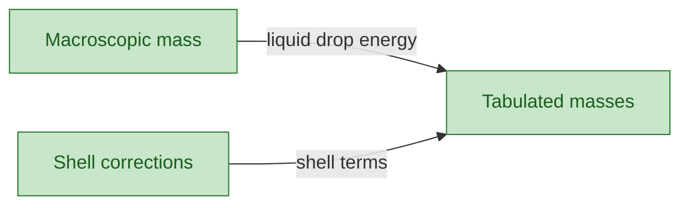

| Node | Meaning | Terms | Status |
| --- | --- | --- | --- |
| `MacroscopicMass` | Smooth part of a nuclear mass: the liquid drop, pairing, deformation and Coulomb energies. | liquid drop mass, pairing energy, deformation energy, Coulomb energy | implemented |
| `ShellCorrections` | Shell and even-odd corrections added to the smooth part of a nuclear mass. | shell correction | implemented |
| `TabulatedMasses` | Mass values from the mass table, with the Q value for beta decay and a validity flag. | mass table, Q value, validity flag | implemented |

#### L3 · Scission shapes (`ScissionShapes`)


| Node | Meaning | Terms | Status |
| --- | --- | --- | --- |
| `CurvatureLimits` | Mass curvature along the path to scission and the two functions that limit it. | mass curvature | implemented |
| `ScissionEquilibrium` | Energy change from the saddle to scission, and the fragment deformations that set charge equilibrium. | scission energy, charge equilibrium | implemented |
| `DeformationMinimum` | Deformation at the minimum of the scission energy, with a flag when no minimum converges. | deformation minimum, non converged minimum | implemented |

#### L3 rule · E2 cascade (`E2Cascade`)

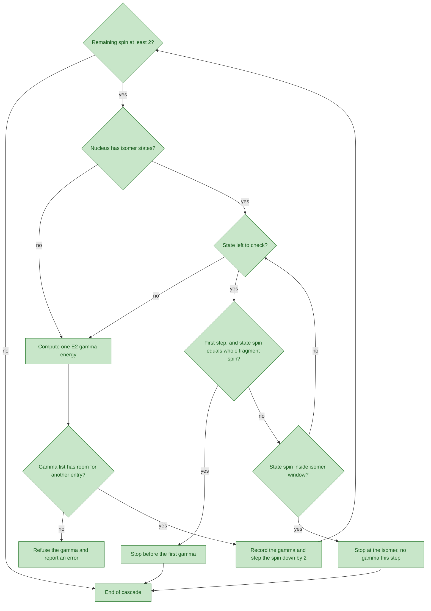

| Node | Meaning | Terms | Status |
| --- | --- | --- | --- |
| `PfSpinAtLeastTwo` | Checks whether the remaining spin is at least 2, so that another gamma can follow. | spin step | implemented |
| `PfIsomerTableCheck` | Checks whether the fragment has isomer states to test. | isomer | implemented |
| `PfStateLoop` | Goes through the isomer states one by one. | isomer | implemented |
| `PfGroundSpinCheck` | Checks for the ground state stop on the first step, when a state carries the whole fragment spin. | ground state stop | implemented |
| `PfWindowCheck` | Checks whether a state spin lies inside the isomer window. | isomer window | implemented |
| `PfListLimit` | Checks that the gamma list has room for another entry. | gamma list limit | implemented |
| `PfGroundStop` | Ends the cascade before the first gamma. | ground state stop | implemented |
| `PfIsomerStop` | Ends the cascade at an isomer, so this step emits no gamma. | isomer stop | implemented |
| `PfEmitGamma` | Computes the energy of one E2 gamma. | E2 gamma | implemented |
| `PfListOverflow` | Refuses another gamma and reports an error. | gamma list limit | implemented |
| `PfStepDown` | Keeps the gamma and lowers the spin by 2. | spin step, E2 gamma | implemented |
| `PfEnd` | Finishes the E2 cascade of one fragment. | E2 cascade | implemented |

### L2 · Run control (`RunControl`)
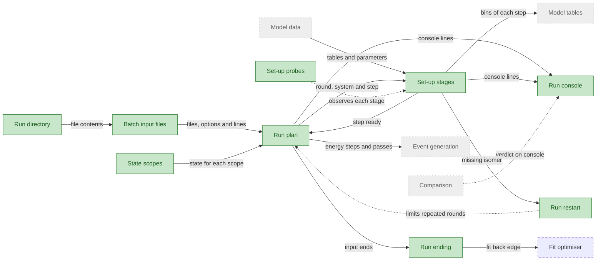

| Node | Meaning | Terms | Status |
| --- | --- | --- | --- |
| `BatchInputFiles` | Reads the batch file and the sequence files it names, with their options, system lines and data lines. | batch input, batch file, sequence file | implemented |
| `RunPlan` | Walks the input rounds, sequence files, systems, energy steps and passes in the order of the reference program. | input round, energy step, pass | implemented |
| `SetupStages` | Sets up each round, system and energy step before its passes, in three stages that the run calls in turn. | set-up stage | implemented |
| `StateScopes` | Keeps the run's state in four scopes, each reset at its own point in the run. | state scope, process scope, round scope, file scope, step scope | implemented |
| `RunRestart` | Starts the batch input again when set-up finds no isomer for a step; a round start seen before makes the run hang. | missing-isomer restart, round start | implemented |
| `RunEnding` | Ends the run as finished, at an end statement, at a fit back edge, or at a hang where the reference would wait for ever. | run end, fit back edge, run hang, end statement | implemented |
| `RunConsole` | Writes the run's console text, which must equal the reference console byte for byte. | run console | implemented |
| `RunWorkDir` | Names and reads the files of the run directory without changing the process's directory. | run directory | implemented |
| `SetupProbes` | Test hooks that report the sequence-file, set-up and threshold stages to a sink; nothing is reported without one. | set-up probe, P0, P1, P1b | implemented |
| `FitOptimiser` | Refines the fit parameters over the fit iterations after the first; it is committed with the fit-mode work. | fit iteration | planned |
| `ModelData` | See GEF in C++. |  | external |
| `ModelTables` | See GEF in C++. |  | external |
| `EventGeneration` | See GEF in C++. |  | external |
| `Comparison` | See GEF in C++. |  | external |

#### L3 · Batch input (`BatchInputFiles`)
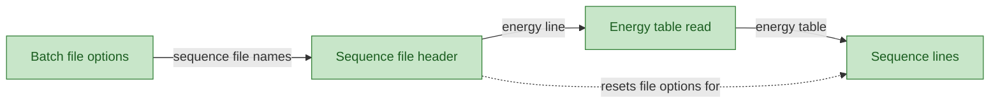

| Node | Meaning | Terms | Status |
| --- | --- | --- | --- |
| `BatchFileOptions` | Reads the top-level batch file: its fit switch and iteration count, and the list of sequence files it names. | batch file, fit switch, iteration count | implemented |
| `SequenceFileHeader` | Reads the energy line of one sequence file and resets the file options that each file starts from. | sequence file, file options, energy line | implemented |
| `EnergyTableRead` | Reads the energy table that an energy line names, and keeps the earlier table for a spectrum-file line. | energy table | implemented |
| `SequenceLines` | Reads the option, system, pair and data lines of a sequence file in order, to the end of its data. | option line, system line, pair line, data line, run mode | implemented |

#### L3 · Run plan (`RunPlan`)
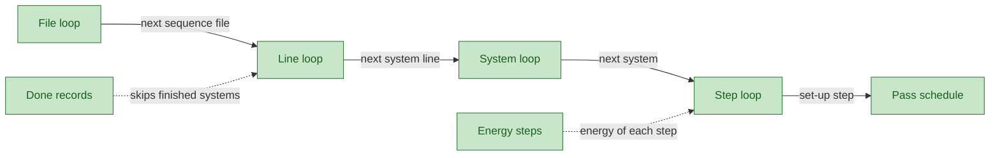

| Node | Meaning | Terms | Status |
| --- | --- | --- | --- |
| `FileLoop` | Walks the sequence files of an input round in order, each one read before its lines. | sequence file, input round | implemented |
| `LineLoop` | Walks the system lines of a sequence file and selects the entrance channel of each. | system line, entrance channel | implemented |
| `SystemLoop` | Walks the systems of a system line in turn; a system that is not bound is passed over. | system line, bound system | implemented |
| `StepLoop` | Walks the energy steps of a system, sets up each one and hands it on, or restarts or ends the run. | energy step, step set-up | implemented |
| `EnergySteps` | Gives each energy step its energy, taken from the energy table or from the ENDF energies. | energy step, energy table, ENDF energy | implemented |
| `PassSchedule` | Hands each set-up step to event generation as passes, and reports when the next step is ready. | pass | implemented |
| `DoneRecords` | Keeps the systems already finished in this process, so that a repeated system is skipped outside fit mode. | done record | implemented |

#### L3 · Set-up stages (`SetupStages`)
```mermaid
flowchart LR
classDef implemented fill:#c8e6c9,stroke:#2e7d32,color:#1b5e20
classDef partial fill:#fff3b0,stroke:#b58900,color:#5c4400
classDef planned stroke-dasharray:6 4
classDef external fill:#eeeeee,stroke:#9e9e9e,stroke-dasharray:1 3,color:#616161
RoundSetup["Round set-up"]
SystemSetup["System set-up"]
StepSetup["Step set-up"]
RoundSetup -->|parameters and widths| SystemSetup
SystemSetup -->|bound system| StepSetup
class RoundSetup,SystemSetup,StepSetup implemented
```

| Node | Meaning | Terms | Status |
| --- | --- | --- | --- |
| `RoundSetup` | Reads the fit parameter file and recomputes the perturbation widths at the start of each input round. | round set-up, input round, fit parameter file, perturbation width | implemented |
| `SystemSetup` | Sets the system's name and output name, prints its barriers and masses, and passes over a system that is not bound. | system set-up, bound system | implemented |
| `StepSetup` | Sets up one energy step: its isomer, spectrum, excitation and energy checks, then the threshold and the pre-pass decision. | step set-up, pre-pass decision, threshold | implemented |

#### L3 rule · Run restart (`RunRestart`)
```mermaid
flowchart TD
classDef implemented fill:#c8e6c9,stroke:#2e7d32,color:#1b5e20
classDef partial fill:#fff3b0,stroke:#b58900,color:#5c4400
classDef planned stroke-dasharray:6 4
classDef external fill:#eeeeee,stroke:#9e9e9e,stroke-dasharray:1 3,color:#616161
RcMissingIsomer["Set-up finds no isomer for the energy step"]
RcRoundSeen{"Same round start as an earlier round?"}
RcRepeatHang["The round would repeat for ever: run hangs"]
RcRecordRound["Record this round start"]
RcRepeatInput["Read the batch input again from its start"]
RcMissingIsomer --> RcRoundSeen
RcRoundSeen -->|yes| RcRepeatHang
RcRoundSeen -->|no| RcRecordRound
RcRecordRound --> RcRepeatInput
class RcMissingIsomer,RcRoundSeen,RcRepeatHang,RcRecordRound,RcRepeatInput implemented
```

| Node | Meaning | Terms | Status |
| --- | --- | --- | --- |
| `RcMissingIsomer` | Set-up finds no isomer for the energy step, so the batch input is read again. | missing-isomer restart | implemented |
| `RcRoundSeen` | Asks whether the round start equals one that an earlier round already had. | round start | implemented |
| `RcRepeatHang` | The round would repeat for ever, so the run hangs. | run hang | implemented |
| `RcRecordRound` | Records this round start for the comparisons of later rounds. | round start | implemented |
| `RcRepeatInput` | Reads the batch input again from its start, as a new input round. | input round | implemented |

#### L3 rule · Run ending (`RunEnding`)
```mermaid
flowchart TD
classDef implemented fill:#c8e6c9,stroke:#2e7d32,color:#1b5e20
classDef partial fill:#fff3b0,stroke:#b58900,color:#5c4400
classDef planned stroke-dasharray:6 4
classDef external fill:#eeeeee,stroke:#9e9e9e,stroke-dasharray:1 3,color:#616161
RcFileListEnd["Every sequence file of the input round is done"]
RcFitIterations{"Fit mode and not at the last fit iteration?"}
RcFitBackEdge["Fit back edge: the fit loop starts again"]
RcBatchNamesSequence{"The batch file names a sequence file?"}
RcHangNoSequence["Hang: the reference waits for a key for ever"]
RcRunFinished["Closing lines printed and the run finishes"]
RcFileListEnd --> RcFitIterations
RcFitIterations -->|yes| RcFitBackEdge
RcFitIterations -->|no| RcBatchNamesSequence
RcBatchNamesSequence -->|no| RcHangNoSequence
RcBatchNamesSequence -->|yes| RcRunFinished
class RcFileListEnd,RcFitIterations,RcFitBackEdge,RcBatchNamesSequence,RcHangNoSequence,RcRunFinished implemented
```

| Node | Meaning | Terms | Status |
| --- | --- | --- | --- |
| `RcFileListEnd` | Every sequence file of the input round has been read and run. | sequence file | implemented |
| `RcFitIterations` | Asks whether fit mode is on and the last fit iteration is not yet reached. | fit iteration, fit mode | implemented |
| `RcFitBackEdge` | The run returns to the start of the fit loop for the next fit iteration. | fit back edge, fit loop | implemented |
| `RcBatchNamesSequence` | Asks whether the batch file names a sequence file at all. | batch file | implemented |
| `RcHangNoSequence` | The batch file names no sequence file, so the reference waits for a key for ever and the run hangs. | run hang | implemented |
| `RcRunFinished` | Prints the closing lines and finishes the run. | run end | implemented |

### L2 · Model tables (`ModelTables`)

```mermaid
flowchart LR
classDef implemented fill:#c8e6c9,stroke:#2e7d32,color:#1b5e20
classDef partial fill:#fff3b0,stroke:#b58900,color:#5c4400
classDef planned stroke-dasharray:6 4
classDef external fill:#eeeeee,stroke:#9e9e9e,stroke-dasharray:1 3,color:#616161
RunControl["Run control"] -->|energy steps and passes| BinVisits["Bin visits"]
ModelData["Model data"] -->|model parameters| NominalWorkingCopies["Nominal working copies"]
NominalWorkingCopies -->|working copies| ModesAndDeformations["Modes and deformations"]
BinVisits -->|bin inputs| ModesAndDeformations
CarriedBinTables["Carried bin tables"] -->|values left from earlier bins| ModesAndDeformations
PhysicsFunctions["Physics functions"] -->|functions used| ModeEnergiesAndWidths["Mode energies and widths"]
ModesAndDeformations -->|deformations and relations| ModeEnergiesAndWidths
ModeEnergiesAndWidths -->|barriers and widths| ModeShiftsAndPolarisation["Mode shifts and polarisation"]
ModeShiftsAndPolarisation -->|shifted modes| ModeYields["Mode yields"]
ModeYields -->|yields| ShellsAndTemperatures["Shell effects and temperatures"]
ShellsAndTemperatures -->|temperatures| EvenOddAndSortedEnergies["Even-odd and sorted energies"]
EvenOddAndSortedEnergies -->|sorted energies| FragmentSpins["Fragment spins"]
FragmentSpins -->|fragment spins| BuilderIntegration["Builder integration"]
BuilderIntegration -->|tables for each bin| EventGeneration["Event generation"]
class BinVisits,NominalWorkingCopies,CarriedBinTables implemented
class ModesAndDeformations,ModeEnergiesAndWidths partial
class ModeShiftsAndPolarisation,ModeYields,ShellsAndTemperatures,EvenOddAndSortedEnergies,FragmentSpins,BuilderIntegration planned
class RunControl,ModelData,PhysicsFunctions,EventGeneration external
```

| Node | Meaning | Terms | Status |
| --- | --- | --- | --- |
| `BinVisits` | Hands out the bins of each step in turn and skips the bins that have no events. | bin, bin visit, candidate bin, bin event count | implemented |
| `NominalWorkingCopies` | Copies the nominal model parameters into the working copies that the table builder may change for a bin. | working copy | implemented |
| `CarriedBinTables` | Keeps the model tables from one bin to the next, and the last bin's spin for the next step; the scratch values are not kept. | model table, carried state, last-bin spin, scratch temporary | implemented |
| `ModesAndDeformations` | Builds the centre, the equilibrium deformation and the mean charge and Z-A relation of every mode. | mode, mode centre, mode deformation, mean charge, Z-A relation | partial |
| `ModeEnergiesAndWidths` | Builds the barrier and saddle energies, the overlap modes, the collective temperatures and the widths of the modes. | barrier energy, saddle energy, overlap mode, collective temperature, mode width | partial |
| `ModeShiftsAndPolarisation` | The energy-dependent shifts of the modes, their potential-energy terms and the charge polarisation, with a second round of the Z-A relations. | mode shift, charge polarisation, Z-A relation | planned |
| `ModeYields` | The share of the fission events that each mode receives, with the widths of the modes' mass distributions. | mode yield, mode width | planned |
| `ShellsAndTemperatures` | The shell energies of the fission channels and the intrinsic temperatures of the fragments. | shell energy, intrinsic temperature | planned |
| `EvenOddAndSortedEnergies` | The scission energies of the modes, their even-odd corrections and their order by size. | scission energy, even-odd correction, sorted energy list | planned |
| `FragmentSpins` | The root-mean-square angular momentum of each fragment. | fragment spin | planned |
| `BuilderIntegration` | Runs the table builder for every bin of each step and hands the tables on to event generation. | bin, model table | planned |
| `RunControl` | See GEF in C++. |  | external |
| `ModelData` | See GEF in C++. |  | external |
| `PhysicsFunctions` | See GEF in C++. |  | external |
| `EventGeneration` | See GEF in C++. |  | external |

#### L3 rule · Bin visit decisions (`BinVisits`)

```mermaid
flowchart TD
classDef implemented fill:#c8e6c9,stroke:#2e7d32,color:#1b5e20
classDef partial fill:#fff3b0,stroke:#b58900,color:#5c4400
classDef planned stroke-dasharray:6 4
classDef external fill:#eeeeee,stroke:#9e9e9e,stroke-dasharray:1 3,color:#616161
MtCandidate{"Candidate bin left?"} -->|no| MtDone["Visits end"]
MtCandidate -->|yes| MtMultiChance{"Multi-chance step?"}
MtMultiChance -->|yes| MtGrid["Grid of bins"]
MtMultiChance -->|no| MtSpectrumLines{"Spectrum of energies given?"}
MtSpectrumLines -->|yes| MtSpectrumPoint["One bin per spectrum point"]
MtSpectrumLines -->|no| MtSingleEnergy["Single-energy bin"]
MtGrid --> MtHasEvents{"Bin event count above zero?"}
MtSpectrumPoint --> MtHasEvents
MtSingleEnergy --> MtHasEvents
MtHasEvents -->|no| MtCandidate
MtHasEvents -->|yes| MtVisit["Bin handed out"]
MtVisit --> MtCandidate
class MtCandidate,MtMultiChance,MtGrid,MtSpectrumLines,MtSpectrumPoint,MtSingleEnergy,MtHasEvents,MtVisit,MtDone implemented
```

| Node | Meaning | Terms | Status |
| --- | --- | --- | --- |
| `MtCandidate` | Ends the bin visits when no candidate bin is left in the step. | candidate bin | implemented |
| `MtMultiChance` | Chooses the multi-chance grid for a multi-chance step, rather than the spectrum points or single-energy bin of a first-chance step. | multi-chance step, multi-chance grid, first-chance step, spectrum point, single-energy bin | implemented |
| `MtGrid` | Gives a multi-chance step its grid of proton numbers, neutron numbers and energies. | multi-chance grid, multi-chance step | implemented |
| `MtSpectrumLines` | Chooses the spectrum points of a first-chance step over a single energy. | spectrum point, first-chance step, single-energy bin | implemented |
| `MtSpectrumPoint` | Gives a first-chance step one bin for each of its spectrum points. | spectrum point, first-chance step, bin | implemented |
| `MtSingleEnergy` | Gives a first-chance step without a spectrum one bin, at its single energy. | single-energy bin, first-chance step | implemented |
| `MtHasEvents` | Skips a candidate bin with no events; the others go on to be handed out. | bin event count, candidate bin | implemented |
| `MtVisit` | Hands a bin with events on to the model table build. | bin, model table | implemented |
| `MtDone` | Ends the visits of the step; no candidate bin is left. | bin visit | implemented |

#### L3 · Modes and deformations (`ModesAndDeformations`)

```mermaid
flowchart LR
classDef implemented fill:#c8e6c9,stroke:#2e7d32,color:#1b5e20
classDef partial fill:#fff3b0,stroke:#b58900,color:#5c4400
classDef planned stroke-dasharray:6 4
classDef external fill:#eeeeee,stroke:#9e9e9e,stroke-dasharray:1 3,color:#616161
ModeCentres["Mode centres"] -->|mode centres| ModeDeformations["Mode deformations"]
ModeDeformations -->|deformed fragments| MeanChargeAndRelations["Mean charge and relations"]
class ModeCentres,ModeDeformations implemented
class MeanChargeAndRelations partial
```

| Node | Meaning | Terms | Status |
| --- | --- | --- | --- |
| `ModeCentres` | The mean proton and mass numbers around which each mode is centred. | mode centre, mode | implemented |
| `ModeDeformations` | The equilibrium deformation of each mode's fragments and the deformation energy that goes with it. **Open:** where the messages of the equilibrium solve are printed is not decided yet. | mode deformation, mode | implemented |
| `MeanChargeAndRelations` | The mean proton number of each mode's fragments at every mass number, and the Z-A relations and curvatures fitted to it. Above mass number 360 the reference writes past the bound of its arrays; the current submilestone replaces the error the port raises there with an emulation of those writes (Q-061). | mean charge, Z-A relation, curvature, out-of-bound write | partial |

#### L3 · Mode energies and widths (`ModeEnergiesAndWidths`)

```mermaid
flowchart LR
classDef implemented fill:#c8e6c9,stroke:#2e7d32,color:#1b5e20
classDef partial fill:#fff3b0,stroke:#b58900,color:#5c4400
classDef planned stroke-dasharray:6 4
classDef external fill:#eeeeee,stroke:#9e9e9e,stroke-dasharray:1 3,color:#616161
BarrierEnergies["Barrier energies"] -->|saddle energies| S1Corrections["S1 corrections"]
S1Corrections -->|corrected modes| OverlapModes["Overlap modes"]
OverlapModes -->|extra modes| CollectiveTemperatures["Collective temperatures"]
CollectiveTemperatures -->|temperatures| PolarisationStiffness["Polarisation stiffness"]
PolarisationStiffness -->|stiffness| ModeWidths["Mode widths"]
class BarrierEnergies,S1Corrections,OverlapModes,CollectiveTemperatures,PolarisationStiffness,ModeWidths partial
```

| Node | Meaning | Terms | Status |
| --- | --- | --- | --- |
| `BarrierEnergies` | The barrier energy of each mode above the ground state, and the energy of each mode above its saddle point. | barrier energy, saddle energy | partial |
| `S1Corrections` | Corrections to the first asymmetric mode near particular neutron and proton shells. | S1 correction, mode | partial |
| `OverlapModes` | Two extra modes, numbered 11 and 22, that carry their own barrier and excitation energy. | overlap mode, barrier energy | partial |
| `CollectiveTemperatures` | The collective temperatures of the modes, with the polarisation and asymmetry temperatures that go with them. | collective temperature, mode | partial |
| `PolarisationStiffness` | The stiffness that resists the charge polarisation of each mode. | polarisation stiffness, charge polarisation | partial |
| `ModeWidths` | The mean values and widths of the mode distributions in proton number and polarisation. | mode width, mode | partial |

### L2 · Event generation (`EventGeneration`)

```mermaid
flowchart LR
classDef implemented fill:#c8e6c9,stroke:#2e7d32,color:#1b5e20
classDef partial fill:#fff3b0,stroke:#b58900,color:#5c4400
classDef planned stroke-dasharray:6 4
classDef external fill:#eeeeee,stroke:#9e9e9e,stroke-dasharray:1 3,color:#616161
FbRuntime["FreeBASIC runtime"]
ModelTables["Model tables"]
PhysicsFunctions["Physics functions"]
RunControl["Run control"]
ResultAnalysis["Result analysis"]
OutputWriting["Output writing"]
DistributionSamplers["Distribution samplers"]
EvaporationAndGammaEmission["Evaporation and gamma emission"]
MultiChancePrePass["Multi-chance pre-pass"]
EventStages["Event stages"]
EventLoop["Event loop"]
ListModeRecords["List-mode records"]
ParallelSubstreamMode["Parallel substream mode"]
FbRuntime -->|random numbers| DistributionSamplers
DistributionSamplers -->|draws| MultiChancePrePass
DistributionSamplers -->|draws| EventStages
RunControl -->|energy steps and passes| EventLoop
ModelTables -->|tables of each bin| EventStages
PhysicsFunctions -->|physics values| EvaporationAndGammaEmission
MultiChancePrePass -->|fission chances and bins| EventLoop
EvaporationAndGammaEmission -->|emitted neutrons and gammas| EventStages
EventLoop -->|each event| EventStages
EventStages -->|event record| ListModeRecords
ListModeRecords -->|list-mode records| OutputWriting
EventStages -->|event values| ResultAnalysis
ParallelSubstreamMode -.->|gives each event its own substream| EventLoop
class FbRuntime,ModelTables,PhysicsFunctions,RunControl,ResultAnalysis,OutputWriting external
class DistributionSamplers,EvaporationAndGammaEmission,MultiChancePrePass,EventStages,EventLoop,ListModeRecords,ParallelSubstreamMode planned
```

| Node | Meaning | Terms | Status |
| --- | --- | --- | --- |
| `DistributionSamplers` | Draws random values from the probability shapes of the event model: Gaussian (with its cached second value), box, linear Gaussian, exponential and Maxwell shapes. | sampler, random stream | planned |
| `EvaporationAndGammaEmission` | Decides at each step of de-excitation whether a neutron or a gamma ray is emitted, using separation energies, and draws the random parts of gamma emission. | evaporation competition, separation energy | planned |
| `MultiChancePrePass` | Simulates neutron emission before fission at each energy step, giving the chance of fission after each number of emitted neutrons and the bins of the compound nuclei that fission. | pre-pass, chance, compound nucleus | planned |
| `EventStages` | The stages that take one event from the choice of its mode to the prompt gamma cascade: fragment mass and charge (with rejection), the energy from saddle to scission and its division into intrinsic and collective energy, fragment spins and kinematics with neutron evaporation, and the prompt gammas down to an isomer. | event, mode, fragment, saddle, scission, prompt gamma | planned |
| `EventLoop` | Runs every event of every pass in turn, and stops the run when too many events have negative energy. | event loop, event, pass | planned |
| `ListModeRecords` | Keeps one record for each event with its values and the random numbers that produced them, for list-mode output. | list-mode record | planned |
| `ParallelSubstreamMode` | A parallel way of running events in which each event draws from its own random substream, so that results do not depend on the thread count; judged against the exact C++ code, not against BASIC. | substream, exact mode | planned |
| `FbRuntime` | See GEF in C++. |  | external |
| `ModelTables` | See GEF in C++. |  | external |
| `PhysicsFunctions` | See GEF in C++. |  | external |
| `RunControl` | See GEF in C++. |  | external |
| `ResultAnalysis` | See GEF in C++. |  | external |
| `OutputWriting` | See GEF in C++. |  | external |

### L2 · Result analysis (`ResultAnalysis`)

```mermaid
flowchart LR
classDef implemented fill:#c8e6c9,stroke:#2e7d32,color:#1b5e20
classDef partial fill:#fff3b0,stroke:#b58900,color:#5c4400
classDef planned stroke-dasharray:6 4
classDef external fill:#eeeeee,stroke:#9e9e9e,stroke-dasharray:1 3,color:#616161
EventGeneration["Event generation"]
ModelData["Model data"]
OutputWriting["Output writing"]
AnalyzerRegistry["Analyzer registry"]
HistogramAccumulators["Histogram accumulators"]
ProjectionsAndNormalisation["Projections and normalisation"]
IsomericSplit["Isomeric split"]
DecayYieldPropagation["Decay yield propagation"]
DelayedNeutronYields["Delayed neutron yields"]
ChiSquareTest["Chi-square test"]
ExternalCumulation["External cumulation"]
UncertaintyPipeline["Uncertainty pipeline"]
EventGeneration -->|event values| HistogramAccumulators
AnalyzerRegistry -.->|limits each histogram| HistogramAccumulators
HistogramAccumulators -->|histograms| ProjectionsAndNormalisation
ProjectionsAndNormalisation -->|yields| IsomericSplit
IsomericSplit -->|split yields| DecayYieldPropagation
ExternalCumulation -->|replaces yields and reruns| DecayYieldPropagation
ModelData -->|nuclide data| DecayYieldPropagation
DecayYieldPropagation -->|decay results| DelayedNeutronYields
DecayYieldPropagation -->|decay results| ChiSquareTest
DecayYieldPropagation -->|cumulative yields| UncertaintyPipeline
ProjectionsAndNormalisation -->|yields| OutputWriting
AnalyzerRegistry -->|analyzer headers| OutputWriting
UncertaintyPipeline -->|covariances| OutputWriting
class EventGeneration,ModelData,OutputWriting external
class AnalyzerRegistry implemented
class HistogramAccumulators,ProjectionsAndNormalisation,IsomericSplit,DecayYieldPropagation,DelayedNeutronYields,ChiSquareTest,ExternalCumulation,UncertaintyPipeline planned
```

| Node | Meaning | Terms | Status |
| --- | --- | --- | --- |
| `AnalyzerRegistry` | The fixed table that describes each analyzer by its name, title, axis labels, plot symbol, type, limit and dimension. | analyzer registry, analyzer | implemented |
| `HistogramAccumulators` | Holds the histograms that events are tallied into, grows them when needed, and clears them when a new set of results starts. | histogram | planned |
| `ProjectionsAndNormalisation` | Derives projections of the histograms onto single variables and rescales the counts so that they represent yields. | projection, normalisation | planned |
| `IsomericSplit` | Divides each fragment's yield between its ground state and its isomers, using isomer windows. | isomeric split, isomer window, isomer | planned |
| `DecayYieldPropagation` | Moves yields from parent nuclides to their daughters along the decay branches, in a fixed order, and gives cumulative yields and beta-decay energies. | decay branching, cumulative yield, beta-decay energy | planned |
| `DelayedNeutronYields` | Gives the delayed neutron yield of each emitting nuclide, with the lists of emitters and of antineutrino emitters. | delayed neutron yield, emitter, antineutrino | planned |
| `ChiSquareTest` | Compares the calculated yields with evaluated data for plotting and reports a chi-square value. | chi-square test | planned |
| `ExternalCumulation` | An optional path in which cumulative yields read from an external source replace the calculated ones for a system, the decay step runs again, and an extra output block is written. **Open:** placement and scope to be confirmed. | external cumulation | planned |
| `UncertaintyPipeline` | Turns the perturbed passes into covariances and final standard deviations: each perturbed pass's yields are written to text and read back (so the covariances use the values as the text rounds them), the covariance is built over the passes for one system and for two systems, and the final standard deviations get the program's caps and additions. | uncertainty, perturbed pass, mvd round trip, covariance, final standard deviation | planned |
| `EventGeneration` | See GEF in C++. |  | external |
| `ModelData` | See GEF in C++. |  | external |
| `OutputWriting` | See GEF in C++. |  | external |

### L2 · Output writing (`OutputWriting`)

```mermaid
flowchart LR
classDef implemented fill:#c8e6c9,stroke:#2e7d32,color:#1b5e20
classDef partial fill:#fff3b0,stroke:#b58900,color:#5c4400
classDef planned stroke-dasharray:6 4
classDef external fill:#eeeeee,stroke:#9e9e9e,stroke-dasharray:1 3,color:#616161
ResultAnalysis["Result analysis"]
RunControl["Run control"]
EventGeneration["Event generation"]
ResultsFile["Results file"]
DumpFiles["Dump files"]
Endf6Tapes["ENDF-6 tapes"]
SideFiles["Side files"]
ResultAnalysis -->|results| ResultsFile
ResultAnalysis -->|analyzer headers| DumpFiles
ResultAnalysis -->|cumulative yields| Endf6Tapes
RunControl -->|file plan| ResultsFile
RunControl -->|file plan| Endf6Tapes
EventGeneration -->|list-mode records| SideFiles
class ResultAnalysis,RunControl,EventGeneration external
class ResultsFile,DumpFiles,Endf6Tapes,SideFiles planned
```

| Node | Meaning | Terms | Status |
| --- | --- | --- | --- |
| `ResultsFile` | The main output file of a run, with one section for each result from its title through to the external cumulation section. | output file, results file | planned |
| `DumpFiles` | Writes the dump files, with headers that describe each analyzer and value lines wrapped at a fixed width. | dump, analyzer | planned |
| `Endf6Tapes` | Writes the yields of selected nuclides as ENDF-6 tapes, each nuclide with its own material number and the records the format requires. | ENDF-6 tape, material number | planned |
| `SideFiles` | Writes the optional extra files beside the results, for covariance, parameter, perturbation and list-mode data. | side file | planned |
| `ResultAnalysis` | See GEF in C++. |  | external |
| `RunControl` | See GEF in C++. |  | external |
| `EventGeneration` | See GEF in C++. |  | external |

### L2 · Reference harness (`ReferenceHarness`)
```mermaid
flowchart LR
classDef implemented fill:#c8e6c9,stroke:#2e7d32,color:#1b5e20
classDef partial fill:#fff3b0,stroke:#b58900,color:#5c4400
classDef planned stroke-dasharray:6 4
classDef external fill:#eeeeee,stroke:#9e9e9e,stroke-dasharray:1 3,color:#616161
NeutralityProof["Neutrality check"] -.->|checks| PatchedBuilds["Patched builds"]
PatchedBuilds -->|patch adds probes| StateProbes["State probes"]
PatchedBuilds -->|patch adds draw logs| DrawLogs["Draw logs"]
PatchedBuilds -->|patch adds argument log| ArgumentLog["Argument log"]
PatchedBuilds -->|patch adds reseeding| ReseedMode["Reseed mode"]
SeedCapture["Seed capture"] -->|seed for replay| CleanRunRunner["Clean runs"]
CaptureCorpora["Capture corpora"] -->|inputs| CleanRunRunner
CleanRunRunner -->|captures| ReferenceStore["Reference store"]
FunctionDrivers["Function drivers"] -->|driver captures| ReferenceStore
ReferenceStore -->|source of| StoreGoldens["Store goldens"]
StoreGoldens -.->|checks| StateProbes
class NeutralityProof,PatchedBuilds,StateProbes,DrawLogs,ArgumentLog,ReseedMode,SeedCapture,CleanRunRunner,CaptureCorpora,ReferenceStore,FunctionDrivers,StoreGoldens implemented
```

| Node | Meaning | Terms | Status |
| --- | --- | --- | --- |
| `PatchedBuilds` | Builds of the reference program with a chosen patch set, each with its own build identifier. | patch set, patched build | implemented |
| `StateProbes` | Records of internal state at fixed points of a run, read without changing its results. | probe | implemented |
| `DrawLogs` | Logs of every random draw, with the scope in which the draw happened. | draw log | implemented |
| `ArgumentLog` | Records of the arguments that selected functions receive, with a check that replaying them reproduces the calls. | argument log | implemented |
| `ReseedMode` | A mode of the patched build, switched on at run time, in which the random generator is reseeded at fixed points, each from a seed derived for its scope. | reseed mode, reseed scope | implemented |
| `SeedCapture` | The clock seed of one reference run, recorded so that a later build can replay that run. | seed capture | implemented |
| `CleanRunRunner` | Runs of the reference program in an empty run directory, compared after time-dependent fields are masked. | clean run, output mask | implemented |
| `CaptureCorpora` | Fixed sets of input entries that define which captures are produced. | corpus | implemented |
| `ReferenceStore` | Immutable captures and reference binaries, each described by a manifest. | reference store, capture, manifest | implemented |
| `FunctionDrivers` | Runs of single functions of the reference program, each from a driver source with include and cut directives, with driver goldens for their results. | function driver, driver golden | implemented |
| `StoreGoldens` | Expected values derived from stored captures, which probe and console checks compare against. | golden, derived golden, probe fingerprint | implemented |
| `NeutralityProof` | Evidence that the added probes and logs leave the program's results unchanged. | neutrality check | implemented |

#### L3 · Probe kinds (`StateProbes`)
```mermaid
flowchart LR
classDef implemented fill:#c8e6c9,stroke:#2e7d32,color:#1b5e20
classDef partial fill:#fff3b0,stroke:#b58900,color:#5c4400
classDef planned stroke-dasharray:6 4
classDef external fill:#eeeeee,stroke:#9e9e9e,stroke-dasharray:1 3,color:#616161
ModuleStartProbe["Module start probe"] -->|next probe in run| SequenceProbe["Sequence file probe"]
SequenceProbe -->|next probe in run| StepSetupProbes["Step setup probes"]
StepSetupProbes -->|next probe in run| PrepassProbe["Pre-pass probe"]
PrepassProbe -->|next probe in run| TableInputProbes["Table input probes"]
ProbeFormat["Probe format"] -.->|limits steps and passes| StepSetupProbes
class ModuleStartProbe,SequenceProbe,StepSetupProbes,PrepassProbe,TableInputProbes,ProbeFormat implemented
```

| Node | Meaning | Terms | Status |
| --- | --- | --- | --- |
| `ModuleStartProbe` | Records the module-level state once per process, before any energy step. | probe T0 | implemented |
| `SequenceProbe` | Records the state after each sequence file is read. | probe P0 | implemented |
| `StepSetupProbes` | Records each selected energy step at its start and after its threshold decision. | probe P1, probe P1b | implemented |
| `PrepassProbe` | Records the state at the end of the multi-chance pre-pass. | probe P2 | implemented |
| `TableInputProbes` | Records the table builder's inputs at its entry and before its event loop. | probe P3in, probe P3 | implemented |
| `ProbeFormat` | The line format of probe output, its decoding of hex values, and the choice of steps and passes that get records. | probe line, trace selection | implemented |

### L2 · Comparison (`Comparison`)
```mermaid
flowchart LR
classDef implemented fill:#c8e6c9,stroke:#2e7d32,color:#1b5e20
classDef partial fill:#fff3b0,stroke:#b58900,color:#5c4400
classDef planned stroke-dasharray:6 4
classDef external fill:#eeeeee,stroke:#9e9e9e,stroke-dasharray:1 3,color:#616161
OutputParsers["Output parsers"] -->|observable values| RunLoading["Run loading"]
ParserFidelity["Parser fidelity"] -.->|checks| OutputParsers
RunLoading -->|observables| ExactComparison["Exact comparison"]
RunLoading -->|observables| StatisticalVerdict["Statistical verdict"]
CalibrationEnsembles["Null ensembles"] -->|null calibration| StatisticalVerdict
ValidityChecks["Validity checks"] -.->|checks false alarms| StatisticalVerdict
FaultInjection["Fault injection"] -.->|checks sensitivity| StatisticalVerdict
LibraryCheck["Library check"] -->|tapes judged| StatisticalVerdict
LibraryRegeneration["Library regeneration"] -->|regenerated tapes| LibraryCheck
CalibrationRevalidation["Parallel-mode calibration"] -.->|checks| CalibrationEnsembles
CoverageMatrix["Coverage matrix"] -.->|names the cells each verdict must cover| ExactComparison
class OutputParsers,ParserFidelity,RunLoading,ExactComparison,StatisticalVerdict,CalibrationEnsembles,ValidityChecks,FaultInjection,LibraryCheck,CoverageMatrix implemented
class LibraryRegeneration,CalibrationRevalidation planned
```

| Node | Meaning | Terms | Status |
| --- | --- | --- | --- |
| `RunLoading` | Reads the files of a run into observables, reusing a compact cached extract of each run. | observable, extract | implemented |
| `OutputParsers` | Readers that turn each kind of output file into observables. | output parser | implemented |
| `ParserFidelity` | Checks that each parser reads reference files back to the values they hold. | parser fidelity | implemented |
| `ExactComparison` | Compares two runs value by value, reporting each difference by its distance in units of the last place. | exact comparison | implemented |
| `CalibrationEnsembles` | Sets of null runs with different seeds, whose spread defines the expected behaviour. | null ensemble, null calibration | implemented |
| `StatisticalVerdict` | Decides, family by family, whether a candidate run is consistent with a null calibration. | statistical verdict, family | implemented |
| `ValidityChecks` | Checks that the verdict's false-alarm rate on known-good runs matches its stated level. | validity check, false alarm, held-out run | implemented |
| `FaultInjection` | Inserts known synthetic faults into good runs and checks that the verdict finds those above the minimum detectable effect. | synthetic fault, sensitivity check, minimum detectable effect | implemented |
| `LibraryCheck` | Judges reference library tapes against a full null calibration, as information only. | library tape | implemented |
| `LibraryRegeneration` | Regenerates every reference library tape from the reference program and compares each one. | library regeneration | planned |
| `CalibrationRevalidation` | Null-calibrated statistical checks for the parallel mode. | parallel-mode calibration | planned |
| `CoverageMatrix` | The matrix of GEF's dimensions (systems, entrance channels, energies, options, observables, internal behaviour) against the test tiers T0–T5, recording which cells are proven and by what. | coverage matrix, test tier | implemented |

#### L3 rule · Verdict rule (`StatisticalVerdict`)
```mermaid
flowchart TD
classDef implemented fill:#c8e6c9,stroke:#2e7d32,color:#1b5e20
classDef partial fill:#fff3b0,stroke:#b58900,color:#5c4400
classDef planned stroke-dasharray:6 4
classDef external fill:#eeeeee,stroke:#9e9e9e,stroke-dasharray:1 3,color:#616161
CmFieldClass["Classify each field: constant, numeric, zero, ignored or text"] --> CmHard{"Family present in every null run is missing, or structural text differs?"}
CmHard -->|yes| CmFail["Suite fails"]
CmHard -->|no| CmVariance["Variance model for each numeric field"]
CmVariance --> CmDeviation["Standardized deviations: sum of squares and largest absolute value"]
CmDeviation --> CmNull["Leave-one-out null for each family"]
CmNull --> CmLowCount{"Discrete counts with at most 20 per run?"}
CmLowCount -->|yes| CmBinomial["Binomial conditional test"]
CmLowCount -->|no| CmFamilyP["Family p-value from global and local laws"]
CmBinomial --> CmHolm["Holm step-down over judged families at level alpha"]
CmFamilyP --> CmHolm
CmHolm -->|some family rejects| CmFail
CmHolm -->|no family rejects| CmPass["Suite passes"]
CmFieldClass -.->|constant deviations cannot reject alone| CmHolm
CmHolm -.->|checks rank of| CmFamilyP
class CmFieldClass,CmHard,CmVariance,CmDeviation,CmNull,CmLowCount,CmBinomial,CmFamilyP,CmHolm,CmFail,CmPass implemented
```

| Node | Meaning | Terms | Status |
| --- | --- | --- | --- |
| `CmFieldClass` | Sorts each field as constant, numeric, zero, ignored or text, which sets how the field is tested. | field class, constant field | implemented |
| `CmHard` | Rejects the suite at once when a family present in every null run is missing or when structural text differs. | hard failure | implemented |
| `CmVariance` | Gives each numeric field a variance estimated from the spread of the null runs. | variance model | implemented |
| `CmDeviation` | Measures how far each candidate value lies from the null mean, in standard errors. | standardized deviation | implemented |
| `CmNull` | Estimates the null law of each family by taking each null run in turn as the candidate. | leave-one-out null | implemented |
| `CmLowCount` | Decides whether a family is made of small discrete counts, which need the binomial test. | low count | implemented |
| `CmBinomial` | Tests a low-count family with a binomial law, conditional on the total count. | binomial conditional test | implemented |
| `CmFamilyP` | Combines the global and local tests of a family into one p-value. | family p-value | implemented |
| `CmHolm` | Applies the step-down correction over all judged families, from the smallest p-value upward. | Holm step-down | implemented |
| `CmFail` | The suite verdict when a family rejects or a hard failure occurs. | suite verdict | implemented |
| `CmPass` | The suite verdict when no family rejects. | suite verdict | implemented |

### L2 · Build checks (`BuildChecks`)
```mermaid
flowchart LR
classDef implemented fill:#c8e6c9,stroke:#2e7d32,color:#1b5e20
classDef partial fill:#fff3b0,stroke:#b58900,color:#5c4400
classDef planned stroke-dasharray:6 4
classDef external fill:#eeeeee,stroke:#9e9e9e,stroke-dasharray:1 3,color:#616161
BuildPresets["Build presets"] -->|apply| CompilerPolicy["Compiler policy"]
ToolchainPin["Toolchain pin"] -->|fixes the compiler for| BuildPresets
FpEnvironmentCheck["FP environment check"] -->|reported in| VersionReport["Version report"]
LocalCiGate["Local CI gate"] -->|runs| BuildPresets
LocalCiGate -->|runs| StaticAnalysis["Static analysis"]
LocalCiGate -->|checks| ToolchainPin
LocalCiGate -->|checks| ValidationManifests["Validation manifests"]
CompilerPolicy -.->|exact FP mode| FbRuntime["FreeBASIC runtime"]
class BuildPresets,CompilerPolicy,ToolchainPin,FpEnvironmentCheck,VersionReport,LocalCiGate,StaticAnalysis,ValidationManifests implemented
class FbRuntime external
```

| Node | Meaning | Terms | Status |
| --- | --- | --- | --- |
| `CompilerPolicy` | The compiler settings that make floating-point arithmetic follow exact rules in every build, with warnings kept on. | exact mode, compiler policy | implemented |
| `BuildPresets` | The named build configurations for each compiler, the sanitizer builds and the exact release build. | preset | implemented |
| `FpEnvironmentCheck` | The start-up check that the floating-point assumptions of exact mode hold on the build machine: float and double computed at their own precision, IEEE 754 formats, round to nearest, and no fused multiply-add; the verdict passes only when all four hold. | fp environment, exact mode | implemented |
| `VersionReport` | The version text the program prints: version, source revision, compiler, build settings and the floating-point verdict. | version report | implemented |
| `ToolchainPin` | The exact compiler version and tarball checksum that the build requires and that is checked before the build. | toolchain pin | implemented |
| `ValidationManifests` | Checksum records that show whether the validation data has changed since it was recorded. | validation manifest | implemented |
| `StaticAnalysis` | The rules that static analysis and formatting apply to the C++ and Python code. | static analysis | implemented |
| `LocalCiGate` | The one local check run that builds, tests and checks the code, with a quick variant for everyday use. | gate, quick mode | implemented |
| `FbRuntime` | See GEF in C++. |  | external |

#### L3 rule · Local CI gate decisions (`LocalCiGate`)
```mermaid
flowchart TD
classDef implemented fill:#c8e6c9,stroke:#2e7d32,color:#1b5e20
classDef partial fill:#fff3b0,stroke:#b58900,color:#5c4400
classDef planned stroke-dasharray:6 4
classDef external fill:#eeeeee,stroke:#9e9e9e,stroke-dasharray:1 3,color:#616161
BcQuickMode{"Is quick mode requested?"} -->|yes| BcBuildGcc["The gcc build is configured, built and tested without slow tests"]
BcQuickMode -->|no| BcToolchain["The toolchain pin is checked"]
BcToolchain --> BcBuildAll["Every build preset is configured, built and tested"]
BcBuildAll --> BcClangBuild{"Did the clang build pass?"}
BcClangBuild -->|yes| BcStaticAnalysis["C++ code is checked by the formatter and the static analyser"]
BcClangBuild -->|no, static analyser is recorded as failed| BcStaticAnalysis
BcStaticAnalysis --> BcPython["Python code is linted, format-checked, type-checked and tested"]
BcBuildGcc --> BcPython
BcPython --> BcValidation{"Is this a full run with validation data present?"}
BcValidation -->|yes| BcVerify["Validation manifests and stored reference results are checked"]
BcValidation -->|no, step is skipped| BcVerdict{"Did any step fail?"}
BcVerify --> BcVerdict
BcVerdict -->|yes| BcFail["The run fails and the change is blocked"]
BcVerdict -->|no| BcPass["The run passes and the change is let through"]
class BcQuickMode,BcBuildGcc,BcToolchain,BcBuildAll,BcClangBuild,BcStaticAnalysis,BcPython,BcValidation,BcVerify,BcVerdict,BcFail,BcPass implemented
```

| Node | Meaning | Terms | Status |
| --- | --- | --- | --- |
| `BcQuickMode` | Chooses between the quick subset of checks and the full run. | quick mode | implemented |
| `BcBuildGcc` | The quick run configures, builds and tests only the gcc preset, without slow tests. | quick mode, preset | implemented |
| `BcToolchain` | The full run first checks the toolchain pin. | toolchain pin | implemented |
| `BcBuildAll` | The full run configures, builds and tests every build preset; sanitizer presets skip slow tests. | preset | implemented |
| `BcClangBuild` | Static analysis of the C++ code needs the clang build, so the analyser runs only when that build passed. | static analysis | implemented |
| `BcStaticAnalysis` | The formatter always checks the C++ code; the static analyser runs only when the clang build passed. | static analysis | implemented |
| `BcPython` | The Python code is linted, format-checked, type-checked and tested. | static analysis | implemented |
| `BcValidation` | Validation checks run only in a full run and only when the validation data is present. | skippable step, validation manifest | implemented |
| `BcVerify` | The validation manifests and the stored reference results are checked against the data. | validation manifest | implemented |
| `BcVerdict` | The run fails when any step failed. | gate | implemented |
| `BcFail` | The gate blocks the change. | gate | implemented |
| `BcPass` | The gate lets the change through. | gate | implemented |
